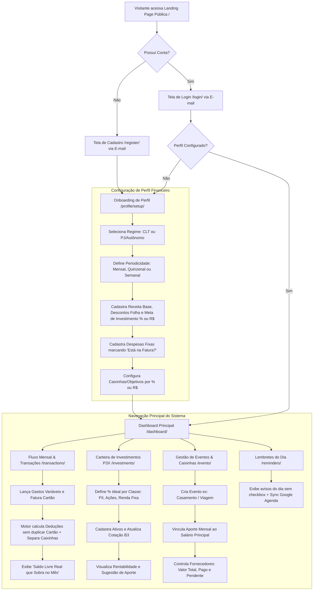

# Product Requirement Document (PRD) — Tallyora

---

## 1. Visão Geral
O **Tallyora** é uma aplicação web *full stack* de gestão de finanças pessoais, controle de investimentos e planejamento financeiro de eventos, desenvolvida com **Python**, **Django** e **TailwindCSS**. O sistema transforma a precisão analítica de planilhas financeiras avançadas em uma plataforma web moderna, automatizada e intuitiva, permitindo que trabalhadores CLT e PJ/Autônomos gerenciem desde seus descontos de folha e faturas de cartão de crédito até suas carteiras de ativos na B3 e orçamentos de grandes projetos de vida (como casamentos e viagens).

---

## 2. Sobre o Produto
Muitos aplicativos financeiros falham em refletir a realidade prática do fluxo de caixa brasileiro: ou duplicam despesas que já estão na fatura do cartão de crédito, ou não sabem lidar com salários quinzenais (vale dia 15 + pagamento dia 30 com descontos em folha), ou tratam o dinheiro guardado de forma desconectada dos grandes projetos do usuário.

O **Tallyora** nasce a partir de uma metodologia validada em planilha real de planejamento financeiro, unificando quatro pilares em uma única interface *Dark Mode*:
1. **Fluxo de Caixa Realista (CLT e PJ):** Cálculo exato de entradas brutas, descontos retidos na fonte, despesas fixas, gastos variáveis e faturas de cartão sem duplicidade.
2. **Alocação Inteligente (Caixinhas e Cofres):** Divisão do saldo disponível por percentual (`%`) ou valor fixo (`R$`), revelando exatamente o "Saldo Livre" que sobra na conta corrente.
3. **Carteira de Investimentos (Estilo P3X / Google Finance):** Controle de FIIs, Ações e Renda Fixa com balanceamento de carteira por metas percentuais e atualização automática de cotações.
4. **Gestão de Eventos e Lembretes Diários:** Administração detalhada de fornecedores e pagamentos para eventos (ex: casamento, viagens) conectada diretamente às caixinhas do orçamento mensal, acompanhada de um painel diário de lembretes (*To-Do visual sem check*).

---

## 3. Propósito
Proporcionar clareza financeira absoluta e paz de espírito ao usuário, eliminando erros de cálculo manual em planilhas e respondendo em tempo real a três perguntas essenciais:
1. *"Quanto dinheiro realmente sobra na minha conta neste período após pagar contas, fatura do cartão e separar meus objetivos?"*
2. *"Como está a evolução do meu patrimônio investido e onde devo aportar este mês segundo minhas metas?"*
3. *"Quanto já paguei, quanto falta pagar e quanto preciso guardar por mês para realizar meus grandes eventos?"*

---

## 4. Público-Alvo
- **Profissionais CLT:** Que recebem mensalmente ou quinzenalmente (adiantamento quinzenal + pagamento final com descontos de INSS, IRRF, consignado, etc.) e buscam organizar gastos fixos no cartão e na conta corrente.
- **Profissionais PJ / Autônomos / Freelancers:** Que possuem receitas variáveis (semanais, quinzenais ou mensais) e necessitam de previsibilidade para cobrir custos fixos e separar percentuais para reserva e investimentos.
- **Investidores Pessoa Física (Iniciantes e Intermediários):** Que investem em FIIs, Ações e Renda Fixa e desejam acompanhar a distribuição da carteira sem complexidade excessiva.
- **Pessoas Planejando Grandes Eventos:** Casais organizando casamento, pessoas planejando viagens ou reformas que precisam controlar múltiplos fornecedores, parcelas e reservas dedicadas.

---

## 5. Objetivos
1. **Curto Prazo (MVP Funcional Local):**
   - Entregar o fluxo completo de autenticação por e-mail, onboarding de perfil (CLT/PJ), motor de cálculo financeiro mensal/quinzenal/semanal sem duplicidade de cartão e separação em caixinhas (% ou R$).
   - Disponibilizar o Dashboard consolidado, o módulo de Eventos (fornecedores/pagamentos), a carteira de investimentos com atualização de ativos e o quadro de lembretes diários.
2. **Médio Prazo:**
   - Integrar sincronização de leitura com a API do Google Calendar para os lembretes do dia e consolidar a busca automática de cotações da B3 via `brapi.dev` / `yfinance`.
3. **Qualidade Técnica:**
   - Manter uma base de código 100% aderente à PEP8, enxuta (*zero over-engineering*), usando recursos nativos do Django (CBVs, DTL, ORM) e banco PostgreSQL.

---

## 6. Requisitos Funcionais

### 6.1. Autenticação e Página Pública (`users` & `core`)
- **RF01 - Landing Page Pública:** Página inicial de apresentação do Tallyora com chamadas para ação (CTAs) de "Cadastre-se" e "Entrar".
- **RF02 - Autenticação via E-mail:** Cadastro, login, logout e recuperação de senha utilizando o sistema nativo do Django customizado para autenticar exclusivamente via `email` e `password`.
- **RF03 - Redirecionamento Pós-Login:** Todo login bem-sucedido deve redirecionar o usuário imediatamente para o Dashboard Principal (`/dashboard/`).

### 6.2. Onboarding e Perfil Financeiro (`profiles`)
- **RF04 - Regime de Trabalho e Periodicidade:** O usuário deve selecionar se é `CLT` (receita fixa) ou `PJ/Autônomo` (receita variável).
  - Se `CLT`: escolhe recebimento **Mensal** ou **Quinzenal** (permitindo configurar percentual de adiantamento no dia 15, ex: 40%, e salário no dia 30, ex: 60%).
  - Se `PJ`: escolhe ciclo de apuração **Semanal**, **Quinzenal** ou **Mensal**.
- **RF05 - Descontos de Folha (Exclusivo/Opcional CLT):** Registro de descontos retidos direto na fonte (INSS, IRRF, Empréstimo Consignado, Coparticipação Saúde, etc.) para cálculo automático do Salário Líquido real que cai na conta.
- **RF06 - Definição de Alocação para Investimentos:** Campo no perfil indicando se o usuário investe (`boolean`) e qual valor fixo (`R$`) ou porcentagem (`%`) da renda líquida destina mensalmente aos investimentos.

### 6.3. Contas, Categorias e Transações (`accounts`, `categories`, `transactions`)
- **RF07 - Gestão de Contas e Cartões:** Cadastro de contas bancárias (ex: Nubank, Itaú) e cartões de crédito vinculados (com dia de fechamento e vencimento da fatura).
- **RF08 - Categorização:** Cadastro de categorias de receitas e despesas (ex: Moradia, Alimentação, Transporte, Lazer, Assinaturas).
- **RF09 - Despesas Fixas e Variáveis com Controle de Fatura:**
  - Cadastro de despesas fixas recorrentes (ex: Aluguel, Internet, Academia, Spotify) e gastos variáveis do período.
  - **Flag Anti-Duplicidade (`is_on_credit_card`):** Todo lançamento de despesa deve ter a marcação *"Está na fatura do cartão?"*.
  - Se `is_on_credit_card = True`, o valor soma no total da **Fatura do Cartão** do período, mas **não é descontado avulsamente** do saldo líquido em conta, evitando cobrança dupla quando a fatura é abatida.
- **RF10 - Motor de Fechamento do Período:**
  - Fórmula base do período:
    $$\text{Saldo Após Gastos} = \text{Receita Líquida} - (\text{Gastos Fixos Fora do Cartão} + \text{Gastos Variáveis Fora do Cartão} + \text{Total Fatura do Cartão})$$
  - Fórmula do Saldo Livre (O que sobra no mês):
    $$\text{Saldo Livre Final} = \text{Saldo Após Gastos} - (\text{Alocação Investimentos} + \text{Total Separado para Caixinhas/Eventos})$$

### 6.4. Caixinhas / Cofres e Gestão de Eventos (`goals_events`)
- **RF11 - Caixinhas (Objetivos Financeiros):** Criação de caixinhas/cofres (ex: Reserva de Emergência, Reforma, Fundo de Viagem) onde o usuário define o aporte periódico por **Porcentagem (%)** ou **Valor Fixo (R$)** sobre o saldo disponível, acompanhando o saldo acumulado e onde está guardado (ex: Cofrinho Banco, CDB Liquidez Diária).
- **RF12 - Administrador de Eventos (Casamento, Viagens, etc.):**
  - Criação de um evento contendo: Nome (ex: *Casamento*, *Viagem*), Orçamento Estimado, Valor Já Guardado e Valor de Aporte Mensal (que entra automaticamente como separador/compromisso na tela principal do salário).
  - **Gestão de Fornecedores/Itens do Evento:** Dentro do evento, o usuário cadastra cada item de gasto (ex: Assessoria, Buffet, Fotógrafo, Hospedagem), Valor Total Contratado, Valor Já Pago, Saldo Pendente e Status (`Pendente`, `Em Andamento`, `Quitado`).
  - Cálculo automático de quanto falta guardar para cobrir todos os fornecedores pendentes do evento.

### 6.5. Carteira de Investimentos (`investments`)
- **RF13 - Cadastro e Divisão Ideal da Carteira (Inspiração P3X):**
  - Definição da estratégia macro da carteira por classe de ativo em porcentagem (ex: 50% FIIs, 25% Ações, 25% Renda Fixa) e meta percentual por ativo dentro da classe.
- **RF14 - Gestão de Ativos e Atualização de Cotações:**
  - Cadastro de ativos contendo: Classe (`FII`, `STOCK`, `FIXED_INCOME`, `CRYPTO`), Ticker/Nome (ex: `MXRF11`, `BBAS3`, `Tesouro Selic`), Quantidade, Preço Médio de Compra e Nota/Peso.
  - Integração com serviço de consulta de cotações (via biblioteca `yfinance` ou API `brapi.dev` acionada via botão "Atualizar Cotações" ou rotina ao carregar a carteira) para buscar o preço atual de ativos da B3, calculando automaticamente: Valor Atual Total, Lucro/Prejuízo (`R$` e `%`), `% Atual na Carteira` vs `% Ideal`, e indicativo visual de qual ativo precisa de aporte (`Aportar` / `Aguardar`).

### 6.6. Lembretes Diários (`reminders`)
- **RF15 - To-Do List Visual do Dia (Sem Check):**
  - Painel lateral ou card dedicado no Dashboard exibindo os compromissos e lembretes apenas do dia corrente (`date = today`).
  - **Sem Checkbox de Conclusão:** Os itens funcionam estritamente como avisos visuais para lembrar o usuário do que precisa ser feito no dia (podendo apenas ser adicionados, editados ou removidos).
  - Suporte a cadastro manual rápido no próprio sistema e estrutura preparada para leitura opcional de eventos do dia via Google Calendar API (`OAuth2` somente leitura).

### 6.7. Dashboard Principal (`core` / `transactions`)
- **RF16 - Visão Geral Executiva:**
  - Cards superiores: Receita Líquida do Período, Total de Despesas (Fixas + Variáveis), Valor da Fatura do Cartão, Total Alocado (Investimentos + Caixinhas/Eventos) e Card de destaque para **"Saldo Livre no Mês (O que sobra)"**.
  - Gráfico de Pizza/Donut simples mostrando a proporção do orçamento (`Despesas Essenciais`, `Cartão de Crédito`, `Investimentos`, `Caixinhas/Eventos`, `Saldo Livre`).
  - Listagem rápida dos Lembretes do Dia e resumo do andamento das Caixinhas/Eventos ativos.

---

### 6.8. Flowchart Mermaid — Fluxos de UX



---

## 7. Requisitos Não-Funcionais
- **RNF01 - Simplicidade e Zero Over-engineering:** O projeto não deve utilizar arquiteturas complexas desnecessárias (sem microserviços, sem SPAs em React/Vue separadas, sem Celery/Redis nas sprints iniciais). Tudo deve rodar de forma monolítica, limpa e direta no Django.
- **RNF02 - Padronização de Código (PEP8 & Inglês):** Todo o código-fonte (models, views, forms, urls, variáveis, comentários técnicos) deve ser escrito em **inglês**, seguindo estritamente a **PEP8** e utilizando **aspas simples (`'`)** por padrão.
- **RNF03 - Idioma da Interface (pt-BR):** 100% dos textos exibidos ao usuário final (templates HTML, labels de formulários, mensagens de erro/sucesso, títulos) devem estar em **Português Brasileiro**.
- **RNF04 - Banco de Dados Relacional:** Uso exclusivo do **PostgreSQL** (`psycopg2-binary` / `psycopg`). O arquivo `db.sqlite3` listado na estrutura base inicial deve ser substituído/ignorado em prol do PostgreSQL desde a configuração do banco na Sprint 1.
- **RNF05 - Rastreabilidade Temporal:** Absolutamente todos os models do sistema devem herdar de um `BaseModel` abstrato contendo os campos `created_at` (`DateTimeField(auto_now_add=True)`) e `updated_at` (`DateTimeField(auto_now=True)`).
- **RNF06 - Uso de Recursos Nativos e CBVs:** Priorizar Class-Based Views (`ListView`, `CreateView`, `UpdateView`, `DeleteView`, `TemplateView`, `FormView`), Django Forms/ModelForms e Django Template Language (DTL).
- **RNF07 - Isolamento de Signals:** Qualquer *signal* (`post_save`, `pre_save`, etc.) deve residir exclusivamente em um arquivo `signals.py` dentro de sua respectiva app e ser registrado no método `ready()` do `apps.py`.
- **RNF08 - Segurança e Isolamento de Dados (Multi-tenant lógico):** Todas as queries (`get_queryset`) nas CBVs devem filtrar obrigatoriamente por `user=self.request.user` juntamente com `LoginRequiredMixin`, garantindo que um usuário jamais acesse dados financeiros de outro.

---

## 8. Arquitetura Técnica

### 8.1. Stack Tecnológica
- **Linguagem:** Python 3.12+
- **Framework Web:** Django 5.x (Full Stack)
- **Frontend:** Django Template Language (DTL) + TailwindCSS (via CDN configurada ou CLI standalone) + Chart.js (apenas para o gráfico pizza/donut do Dashboard e da Carteira).
- **Banco de Dados:** PostgreSQL 16+
- **Integração de Cotações B3:** Biblioteca `yfinance` ou requisições HTTP via `requests` para a API pública `brapi.dev`.
- **Integração de Agenda (Fase Final):** Google Calendar API (`google-api-python-client`, `google-auth-oauthlib`) em modo *read-only*.
- **Infraestrutura & Qualidade (Sprints Finais):** Docker, Docker Compose e `pytest` / `django.test`.

### 8.2. Arquitetura de Diretórios Expandida
Mantendo a estrutura inicial solicitada e adicionando as apps de domínio estritamente necessárias para cobrir Caixinhas/Eventos, Investimentos e Lembretes:

```text
tallyora/
├── accounts/          # Contas bancárias e cartões de crédito
├── categories/        # Categorias de lançamentos (entradas e saídas)
├── core/              # Configurações globais, BaseModel, Landing Page e Dashboard
├── goals_events/      # Caixinhas (cofres) e Planejador de Eventos (ex: Casamento)
├── investments/       # Carteira de investimentos (P3X style), classes e ativos
├── profiles/          # Perfil financeiro (CLT/PJ, periodicidade, descontos folha)
├── reminders/         # To-Do List diário sem check e integração Google Calendar
├── transactions/      # Entradas, despesas fixas/variáveis e fechamento de fatura
├── users/             # CustomUser com login via e-mail
├── templates/         # Templates base e parciais do Design System
├── static/            # Arquivos estáticos customizados
└── manage.py
```

### 8.3. Estrutura de Dados (Schema Mermaid ERD)

```mermaid
erDiagram
    CustomUser ||--|| UserProfile : "possui"
    CustomUser ||--o{ PayrollDeduction : "possui descontos CLT"
    CustomUser ||--o{ BankAccount : "possui"
    CustomUser ||--o{ Category : "possui"
    CustomUser ||--o{ Transaction : "realiza"
    CustomUser ||--o{ RecurringExpense : "configura fixos"
    CustomUser ||--o{ GoalBox : "aloca caixinhas"
    CustomUser ||--o{ EventPlan : "administra eventos"
    CustomUser ||--o{ AssetAllocationTarget : "define metas P3X"
    CustomUser ||--o{ InvestmentAsset : "investe em"
    CustomUser ||--o{ DailyReminder : "visualiza no dia"

    BankAccount ||--o{ Transaction : "movimenta"
    BankAccount ||--o{ RecurringExpense : "cobra em"
    Category ||--o{ Transaction : "classifica"
    Category ||--o{ RecurringExpense : "classifica"
    EventPlan ||--o{ EventExpenseItem : "contém fornecedores"
    GoalBox ||--o| EventPlan : "financia (opcional)"

    CustomUser {
        bigint id PK
        string email UK "USERNAME_FIELD"
        string first_name
        string last_name
        boolean is_active
        datetime created_at
        datetime updated_at
    }

    UserProfile {
        bigint id PK
        bigint user_id FK
        string work_regime "CLT | PJ"
        string payment_frequency "WEEKLY | BIWEEKLY | MONTHLY"
        decimal base_gross_income "Receita Bruta Base"
        decimal advance_percentage "Ex: 40.00 para quinzena CLT"
        boolean has_investments
        string investment_allocation_type "PERCENTAGE | FIXED"
        decimal investment_allocation_value
        datetime created_at
        datetime updated_at
    }

    PayrollDeduction {
        bigint id PK
        bigint user_id FK
        string name "Ex: INSS, IRRF, Consignado"
        decimal amount
        boolean is_active
        datetime created_at
        datetime updated_at
    }

    BankAccount {
        bigint id PK
        bigint user_id FK
        string name "Ex: Nubank, Itaú"
        decimal initial_balance
        boolean has_credit_card
        int closing_day
        int due_day
        datetime created_at
        datetime updated_at
    }

    Category {
        bigint id PK
        bigint user_id FK
        string name
        string category_type "INCOME | EXPENSE"
        string color_hex
        datetime created_at
        datetime updated_at
    }

    RecurringExpense {
        bigint id PK
        bigint user_id FK
        bigint category_id FK
        bigint account_id FK
        string title "Ex: Aluguel, Academia, Internet"
        decimal amount
        int due_day
        boolean is_on_credit_card "Evita duplicidade no cálculo"
        string billing_cycle "FIRST_HALF | SECOND_HALF | MONTHLY"
        boolean is_active
        datetime created_at
        datetime updated_at
    }

    Transaction {
        bigint id PK
        bigint user_id FK
        bigint account_id FK
        bigint category_id FK
        string title
        decimal amount
        string transaction_type "INCOME | EXPENSE | CREDIT_CARD_BILL"
        date reference_date
        boolean is_on_credit_card "Se True, compõe a fatura e não desconta 2x"
        boolean is_paid
        datetime created_at
        datetime updated_at
    }

    GoalBox {
        bigint id PK
        bigint user_id FK
        string name "Ex: Reserva de Emergência, Casamento"
        string storage_location "Ex: Cofrinho, CDB"
        string allocation_type "PERCENTAGE | FIXED"
        decimal allocation_value "Valor R$ ou % do saldo"
        decimal current_balance
        decimal target_amount
        datetime created_at
        datetime updated_at
    }

    EventPlan {
        bigint id PK
        bigint user_id FK
        bigint linked_goal_box_id FK
        string title "Ex: Casamento, Viagem"
        date event_date
        decimal already_saved_amount
        string monthly_contribution_type "PERCENTAGE | FIXED"
        decimal monthly_contribution_value
        datetime created_at
        datetime updated_at
    }

    EventExpenseItem {
        bigint id PK
        bigint event_id FK
        string supplier_name "Ex: Assessoria, Buffet, Hospedagem"
        string category_name
        decimal total_cost
        decimal amount_paid
        string payment_status "PENDING | PARTIAL | PAID"
        string notes
        datetime created_at
        datetime updated_at
    }

    AssetAllocationTarget {
        bigint id PK
        bigint user_id FK
        string asset_class "FII | STOCK | FIXED_INCOME | CRYPTO"
        decimal target_percentage "Ex: 50.00 para FII"
        datetime created_at
        datetime updated_at
    }

    InvestmentAsset {
        bigint id PK
        bigint user_id FK
        string asset_class "FII | STOCK | FIXED_INCOME | CRYPTO"
        string ticker "Ex: MXRF11, BBAS3, TESOURO_SELIC"
        string name
        decimal quantity
        decimal average_price
        decimal current_price "Atualizado via API/Manual"
        decimal target_percentage_in_class
        datetime last_quote_update
        datetime created_at
        datetime updated_at
    }

    DailyReminder {
        bigint id PK
        bigint user_id FK
        string title "Apenas lembrete visual sem check"
        time scheduled_time
        date reminder_date
        string external_google_event_id
        datetime created_at
        datetime updated_at
    }
```



---

## 9. Design System (TailwindCSS + Django Template Language)

Todas as telas do **Tallyora** devem herdar de um template mestre (`base.html` para área logada e `base_public.html` para a Landing Page/Auth), garantindo consistência visual absoluta, fundo escuro profundo e gradientes modernos.

### 9.1. Paleta de Cores e Fundo (Dark Mode Nativo)
- **Fundo Principal da Aplicação (`bg-slate-950`):** `#020617`
- **Fundo de Cards e Containers (`bg-slate-900/80` com borda `border-slate-800`):** `#0f172a` com efeito *glassmorphism* sutil (`backdrop-blur-md`).
- **Fundo de Inputs e Tabelas Secundárias (`bg-slate-800/60`):** `#1e293b`
- **Cor Primária e Gradiente Principal (Identidade Tallyora):**
  - Gradiente de destaque: `bg-gradient-to-r from-emerald-500 via-teal-500 to-cyan-500`
  - Primária sólida: `emerald-500` (`#10b981`) para ações principais e indicadores positivos.
  - Secundária/Acento: `indigo-500` (`#6366f1`) e `cyan-400` (`#22d3ee`) para gráficos, caixinhas e investimentos.
- **Cores Semânticas Financeiras:**
  - **Receitas / Lucro / Quitado:** `text-emerald-400` / Badge `bg-emerald-500/10 text-emerald-400 border border-emerald-500/20`
  - **Despesas / Prejuízo / Pendente:** `text-rose-400` / Badge `bg-rose-500/10 text-rose-400 border border-rose-500/20`
  - **Fatura de Cartão / Alerta / Parcial:** `text-amber-400` / Badge `bg-amber-500/10 text-amber-400 border border-amber-500/20`
  - **Caixinhas e Investimentos:** `text-cyan-400` / Badge `bg-cyan-500/10 text-cyan-400 border border-cyan-500/20`
- **Tipografia e Textos:**
  - Título Principal: `text-slate-100`
  - Texto Secundário / Labels: `text-slate-400`
  - Texto Desabilitado / Muted: `text-slate-500`

### 9.2. Tipografia (Fontes)
- **Fonte Principal (UI e Textos):** `Inter` ou `Plus Jakarta Sans` (importada via Google Fonts no `base.html`).
- **Fonte Numérica / Valores Financeiros:** Uso obrigatório da classe utilitária `tabular-nums` (`font-variant-numeric: tabular-nums`) em todos os valores monetários (`R$`) e percentuais (`%`) para alinhamento vertical perfeito em tabelas e cards.

### 9.3. Padrão de Componentes (Classes TailwindCSS no DTL)
- **Botão Primário (CTA / Salvar):**
  ```html
  <button class="inline-flex items-center justify-center px-5 py-2.5 rounded-xl font-semibold text-sm text-slate-950 bg-gradient-to-r from-emerald-400 to-cyan-400 hover:from-emerald-300 hover:to-cyan-300 transition-all duration-200 shadow-lg shadow-emerald-500/20">
    Salvar Registro
  </button>
  ```
- **Botão Secundário (Cancelar / Ações Auxiliares):**
  ```html
  <button class="inline-flex items-center justify-center px-4 py-2.5 rounded-xl font-medium text-sm text-slate-300 bg-slate-800 hover:bg-slate-700 border border-slate-700 transition-colors">
    Cancelar
  </button>
  ```
- **Botão Perigo (Excluir):**
  ```html
  <button class="inline-flex items-center justify-center px-4 py-2.5 rounded-xl font-medium text-sm text-rose-400 bg-rose-500/10 hover:bg-rose-500/20 border border-rose-500/20 transition-colors">
    Excluir
  </button>
  ```
- **Inputs e Selects (Estilizados via `widgets` nos Forms do Django):**
  ```html
  <input class="w-full px-4 py-2.5 rounded-xl bg-slate-900 border border-slate-700 text-slate-100 placeholder-slate-500 focus:outline-none focus:ring-2 focus:ring-emerald-500/50 focus:border-emerald-500 transition-all text-sm" />
  ```
- **Cards de Indicadores (KPIs do Dashboard):**
  ```html
  <div class="p-6 rounded-2xl bg-slate-900/80 border border-slate-800 backdrop-blur-md shadow-xl flex flex-col justify-between">
    <span class="text-xs font-medium uppercase tracking-wider text-slate-400">Saldo Livre no Mês</span>
    <span class="text-2xl font-bold text-emerald-400 tabular-nums mt-2">R$ 1.850,00</span>
  </div>
  ```
- **Grids e Layout Geral (Menus):**
  - **Sidebar Fixa no Desktop (`w-64`):** Menu vertical à esquerda (`bg-slate-900 border-r border-slate-800`) com logo Tallyora em gradiente, links de navegação com ícone + texto (`Dashboard`, `Meu Perfil & Salário`, `Transações & Fatura`, `Caixinhas & Eventos`, `Investimentos P3X`, `Lembretes do Dia`) e botão de Logout no rodapé.
  - **Área de Conteúdo:** Container fluido (`max-w-7xl mx-auto px-4 sm:px-6 lg:px-8 py-8`) com grids responsivos (`grid-cols-1 md:grid-cols-2 lg:grid-cols-4 gap-6`).

---

## 10. User Stories

### Épico 1: Autenticação e Configuração de Perfil Financeiro (CLT / PJ)
- **US01 — Login por E-mail:**
  - *Como* usuário do Tallyora, *quero* criar minha conta e fazer login utilizando meu endereço de e-mail e senha, *para que* eu acesse meu painel financeiro com segurança sem precisar decorar um nome de usuário.
  - **Critérios de Aceite:**
    1. O campo `username` não deve ser exigido no cadastro nem no login; o `email` deve ser único e obrigatório.
    2. Usuários não autenticados que acessarem a raiz `/` devem visualizar a Landing Page pública.
    3. Após autenticar com sucesso, o usuário deve ser redirecionado para `/dashboard/`.
- **US02 — Configuração de Regime CLT ou PJ e Periodicidade:**
  - *Como* trabalhador CLT ou PJ, *quero* configurar se minha renda é fixa (CLT) ou variável (PJ) e a frequência de recebimento (mensal, quinzenal ou semanal), incluindo descontos de folha (INSS, IRRF, consignado), *para que* o sistema calcule automaticamente minha receita líquida real disponível em cada período.
  - **Critérios de Aceite:**
    1. Se selecionado `CLT` + `Quinzenal`, o sistema deve exibir o cálculo separado da 1ª quinzena (ex: 40% adiantamento sem descontos) e da 2ª quinzena (60% menos descontos de folha registrados).
    2. Se selecionado `PJ`, o sistema deve permitir informar a receita variável realizada na semana, quinzena ou mês.

### Épico 2: Controle de Gastos, Fatura sem Duplicidade e Caixinhas
- **US03 — Lançamento de Despesas Fixas e Fatura sem Contabilização Dupla:**
  - *Como* usuário que concentra gastos fixos e variáveis no cartão de crédito, *quero* marcar quais despesas pertencem à fatura do cartão, *para que* o sistema não desconte esses valores duas vezes quando eu lançar o valor total da fatura.
  - **Critérios de Aceite:**
    1. Todo cadastro de gasto fixo ou transação variável deve conter o checkbox *"Está na fatura do cartão?"* (`is_on_credit_card`).
    2. No cálculo do saldo disponível em conta, despesas marcadas com `is_on_credit_card = True` não devem ser subtraídas individualmente do saldo da conta corrente, sendo abatidas apenas através do valor consolidado da fatura do cartão daquele período.
- **US04 — Divisão do Saldo Disponível em Caixinhas por % ou R$ Fixo:**
  - *Como* usuário planejador, *quero* criar caixinhas/objetivos e definir se quero guardar uma porcentagem (`%`) ou um valor fixo (`R$`) do meu orçamento, *para que* o sistema separe esses valores automaticamente e me mostre quanto dinheiro realmente sobra livre no mês.
  - **Critérios de Aceite:**
    1. O formulário da caixinha deve permitir alternar entre `Porcentagem (%)` e `Valor Fixo (R$)`.
    2. O painel principal deve exibir claramente a linha de cálculo: `Receita Líquida (-) Gastos Conta (-) Fatura Cartão (-) Investimentos (-) Caixinhas/Eventos (=) Saldo Livre que Sobra`.

### Épico 3: Carteira de Investimentos Estilo P3X
- **US05 — Gestão de Ativos e Rebalanceamento P3X:**
  - *Como* investidor, *quero* cadastrar meus FIIs, Ações e Renda Fixa definindo a porcentagem ideal de cada classe e atualizar suas cotações automaticamente, *para que* eu acompanhe a evolução do meu patrimônio e saiba onde aportar.
  - **Critérios de Aceite:**
    1. O usuário pode definir metas percentuais por classe (ex: 50% FII, 25% Ações, 25% Renda Fixa) cuja soma valide 100%.
    2. O sistema deve buscar a cotação atual dos tickers da B3 (via API gratuita) ou permitir atualização manual para títulos de Renda Fixa.
    3. A tabela deve exibir Preço Médio, Preço Atual, Posição Total (`R$`), `% Atual` vs `% Ideal` e uma badge indicando se o ativo está abaixo da meta (`Aportar`).

### Épico 4: Planejador de Eventos e Lembretes Diários
- **US06 — Administração de Grandes Eventos (Ex: Casamento / Viagem):**
  - *Como* usuário organizando um grande evento, *quero* cadastrar o evento, vincular o quanto guardo por mês ao meu orçamento principal e listar todos os fornecedores com valores pagos e pendentes, *para que* eu tenha controle total de quanto falta pagar e guardar.
  - **Critérios de Aceite:**
    1. O valor de aporte mensal configurado no evento deve ser deduzido automaticamente no cálculo de separação da tela principal do salário.
    2. Dentro do evento, deve ser possível adicionar múltiplos itens/fornecedores (ex: Buffet, Assessoria, Fotografia, Hospedagem) exibindo `Custo Total`, `Valor Pago`, `Falta Pagar` e barra de progresso geral do evento.
- **US07 — Lembretes Visuais do Dia (To-Do sem Check):**
  - *Como* usuário, *quero* visualizar uma lista simples de lembretes do que tenho para fazer hoje sem precisar marcar tarefas como concluídas, podendo opcionalmente puxar meus compromissos do Google Agenda, *para que* eu não esqueça obrigações financeiras ou pessoais enquanto uso o sistema.
  - **Critérios de Aceite:**
    1. Os itens da lista não devem possuir checkbox de conclusão ("check"), funcionando como um mural limpo de lembretes do dia.
    2. O usuário pode adicionar ou remover lembretes rapidamente pelo Dashboard.

---

## 11. Métricas de Sucesso (KPIs)
- **KPIs de Produto e Engajamento:**
  - **Taxa de Conclusão do Onboarding Financeiro:** $\ge 90\%$ dos usuários cadastrados concluem a configuração de regime (CLT/PJ), despesas fixas e pelo menos 1 caixinha na primeira sessão.
  - **Precisão de Conciliação de Saldo (Zero Duplicidade):** $100\%$ de exatidão matemática entre os lançamentos marcados como "na fatura" e o saldo líquido exibido no Dashboard.
  - **Frequência de Uso Semanal:** Mínimo de 3 acessos semanais por usuário ativo para consulta de lembretes diários, lançamento de gastos variáveis e acompanhamento de eventos.
- **KPIs Técnicos:**
  - **Tempo de Resposta das Views (TTFB):** $< 300\text{ms}$ para renderização do Dashboard e telas de listagem no Django Template Language com PostgreSQL.
  - **Cobertura de Testes (Sprint Final):** $\ge 80\%$ de cobertura nas funções de cálculo financeiro (fechamento de saldo, descontos CLT, rateio de caixinhas e cálculo de eventos).

---

## 12. Riscos e Mitigações

| ID | Risco Identificado | Impacto | Probabilidade | Estratégia de Mitigação |
| :--- | :--- | :---: | :---: | :--- |
| **R01** | Indisponibilidade ou limite de requisições (*rate limit*) em APIs gratuitas de cotação da B3 (`yfinance` / `brapi.dev`). | Médio | Média | Armazenar a última cotação válida no banco (`current_price` e `last_quote_update`) e permitir edição manual de fallback caso a API externa oscile. |
| **R02** | Dupla contagem acidental pelo usuário ao lançar a fatura total do cartão e esquecer de marcar gastos fixos como pertencentes ao cartão. | Alto | Média | Destacar visualmente no formulário de Despesa Fixa e Transação um *toggle* claro ("Pago no Cartão de Crédito?") com texto explicativo sobre a não-duplicação no saldo da conta. |
| **R03** | Complexidade na aprovação OAuth2 da API do Google Calendar em ambiente local. | Baixo | Média | Tornar o módulo de Lembretes 100% funcional via cadastro manual desde a Sprint 5 e implementar o conector do Google Calendar usando credenciais de desenvolvimento local (`localhost`) de forma desacoplada. |
| **R04** | Divergência de cálculo quando a soma das porcentagens das caixinhas ultrapassar 100% do saldo disponível. | Médio | Baixa | Adicionar validação no `clean()` do Model/Form impedindo que a soma das alocações percentuais ativas ultrapasse $100\%$ e alertando quando valores fixos superarem a receita líquida. |

---